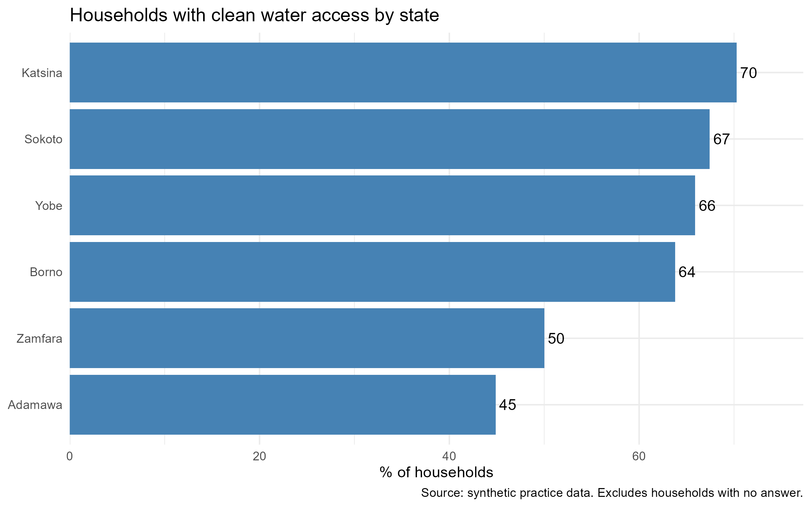
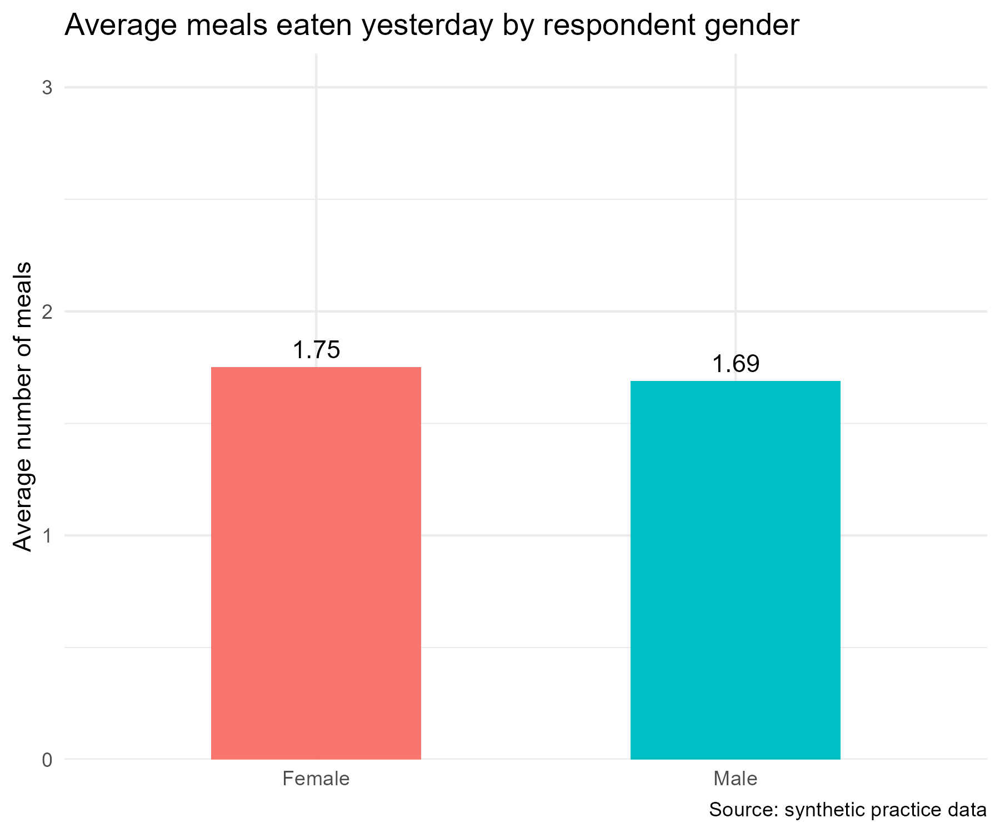
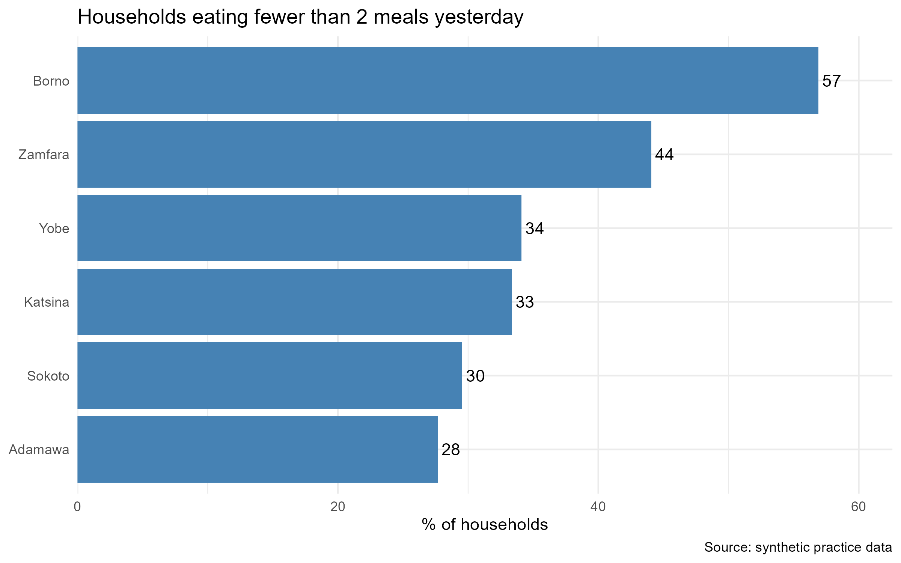

# Household Survey Analysis in R

Cleaning, summarising and visualising a **synthetic** Kobo-style household
survey using R (tidyverse and ggplot2). This is a practice project that
mirrors the kind of data work done in humanitarian needs assessments.

> **Note:** All data in this repository is synthetic and was generated for
> practice. It does not represent real households or real findings.

## What this project shows

- Importing survey data and handling missing-value codes (`-99`, `NA`, `n/a`)
- Cleaning messy text (inconsistent case and spacing), duplicates and
  impossible values
- Summarising by group with `dplyr`
- Building clear, labelled charts with `ggplot2`
- Checking missing data transparently before drawing conclusions

## Dataset

312 raw rows (300 unique households after removing 12 duplicate submissions)
across six states: Borno, Yobe, Adamawa, Zamfara, Katsina and Sokoto.

| Column | Description |
|---|---|
| `_id` | Submission ID |
| `Submission Date` | Date of the interview |
| `State` | State surveyed |
| `Respondent Gender` | Male or Female |
| `Household Size` | Number of people in the household |
| `Meals Yesterday` | Meals eaten the previous day (0 to 3) |
| `Displaced` | Whether the household is displaced (Yes/No) |
| `Monthly Income (NGN)` | Income in naira |
| `Rice Price per kg (NGN)` | Reported market price |
| `Clean Water Access` | Access to clean water (Yes/No) |

## Workflow

1. **Import** with `read_csv()`, telling R which codes mean missing.
2. **Inspect** inconsistent spellings, duplicate IDs and impossible values.
3. **Clean:** standardise text, remove duplicate submissions, convert income
   text to numbers and set household sizes above 30 to missing.
4. **Summarise** by state: sample size, % displaced, % eating fewer than two
   meals, median income and average rice price.
5. **Visualise** the results.

## Selected results

- Clean water access ranges from about 45% (Adamawa) to about 70% (Katsina).

- Average meals yesterday: women 1.75, men 1.69. This difference is very
  small, so no meaningful gender difference should be claimed.

- 22 of 300 households have missing income, from 2.2% (Sokoto) to 14.5%
  (Zamfara). The counts are small, so state differences should be read
  cautiously.
- “A t-test found no meaningful difference in meals by gender (p = 0.5572)”.
   Replace the bracket with your real number.

## Handling missing data

- Report the number and percentage missing for every variable.
- Do not drop whole rows because one variable is missing.
- Compare households with and without income on other variables to check for
  non-response bias before any imputation.
- Report medians for skewed variables such as income, and avoid simple
  mean or median imputation, which understates variation.

## How to run

1. Install RStudio.
2. Open Survey Analysis.Rproj in RStudio
3. Install the packages: `install.packages("tidyverse")`
4. Run `household_survey_analysis.R`.

## Tools

R, tidyverse (readr, dplyr, stringr, lubridate), ggplot2

## Author

George Anya, Abuja, Nigeria
https://www.linkedin.com/in/georgeulah
